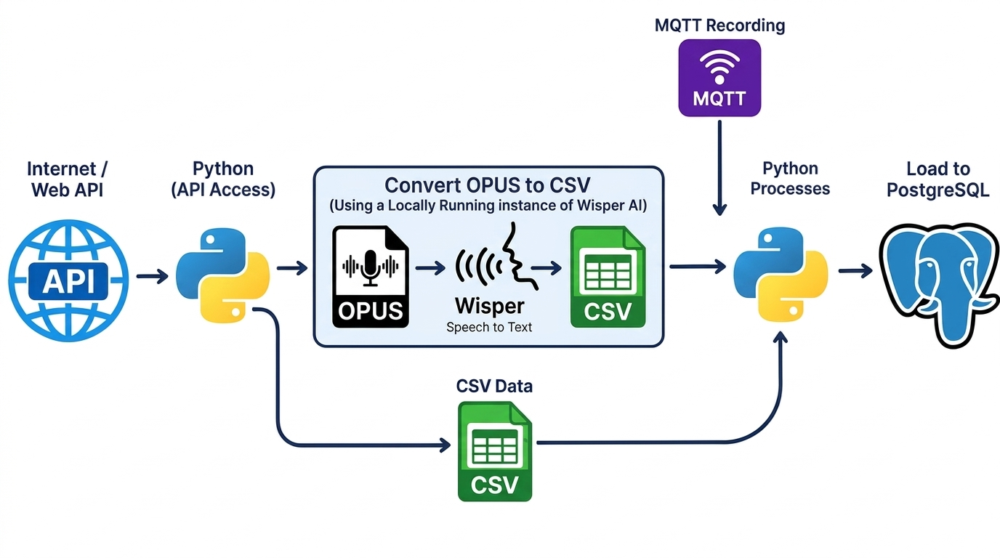
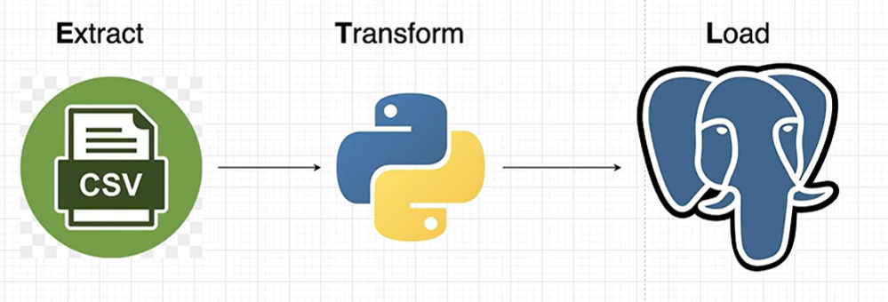

This is a project concerning hypothetical business cases for the EMF Camping festival as a means to demonstrate data engineering skills. 

>EMF (Electromagnetic Field)  
>A non-profit camping festival for those with an inquisitive mind or an interest in making things: hackers, artists, geeks, crafters, scientists, and engineers. It consists of a temporary town of nearly four thousand people enjoying a long weekend of talks, performances, music, and workshops and making on a wide range of topics. 
 

# Overview
This projects aim is to build a data warehouse by ingesting and processing available data. Primarily the focus will be on delivering analysis ready datasets focused the official events for the festival as well as dissecting and organising available recorded MQTT (Message Queuing Telemetry Transport) traffic from sensors at the event so as to be able to provide a descriptive picture of the event concerning things like drink stocks and weather.  

So as to demonstrate ability with both. ELT and ETL approaches have been used separately to achieve this goal. 
  

## [Setup Guide](/Documentation/Setup.md)

## Hypothetical Business cases: 
**Topic modelling: Sponsorship identification**  
 EMF camp has several sponsoring organisations.   It is conceivable that in searching for new ones some descriptive of analysis of the content of a given event could be useful. By modelling topics it may also help the event organisers at a future event make informed decisions about what talks or speakers to invite. 

**Robot Arms Bar Stock provisioning.**  
There is data for sales and available stocks etc that is timestamped. Similarly, there is weather data and potentially other sensor data also timestamped.   
By making available and analysing this data it would be possible to inform the stock provision in the bar to prevent drinks going out of stock when they are in demand.  It would also be hypothetically possible to make predictions on the expected impact on needed provisions due to factors such as weather forecasts modelling based on previous data. 

**Technical outages and other risks in correspondence to heat.**   
The weather at this year’s event was very warm. Infrastructure failures likely have correspondence to the extreme weather that may be quantifiable to a “cause for concern” temperature threshold.  

# ETL 
## Arcitecture 
The full arcitecture of the pipline would be as seen here: 

However due to long compute times and the high likelyhood of the disaperance of the endpoint the notebooks mostly run from the generated files.  This simplifes then to : 

## Data Model
[Insert Entity relationship diagram here.] 
Questions to consider: what normalisation level? Reasons to choose given fact or dim, ensure refresh fundementals on this. 

# Current todo 
- [] Refactor to send not tabular data to landing zone and then subseqently to bronze silver gold etc.
- Seperate notebooks into folders Extract, Transform and load refactoring as neccesary. 
- Data from experements like getting weather, villages etc should have their own notebooks. mqtt_get_villages.ipynb etc. 

# Refrences

[Notes_Scedule](Documentation/Assets/EMFCamp%20Notes/Scedule_Notes.md)  
[Notes_MQTT](Documentation/Assets/EMFCamp%20Notes/MQTT%20notes.md)  
[Learning source1](https://www.youtube.com/watch?v=G0crKzK9Ayk)

### Other potentially useful titbits.  
[MQTT Visualiser](https://ryanbateman.github.io/mqtt_vis/?broker=wss%3A%2F%2Fmqtt.emf.camp%3A15676%2Fws&topic=%23)